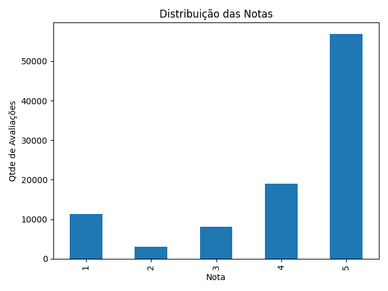
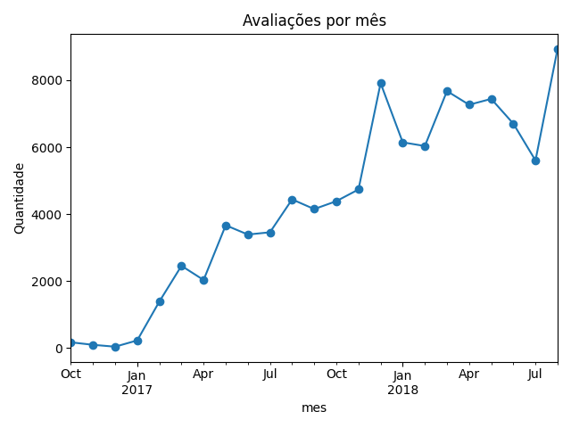
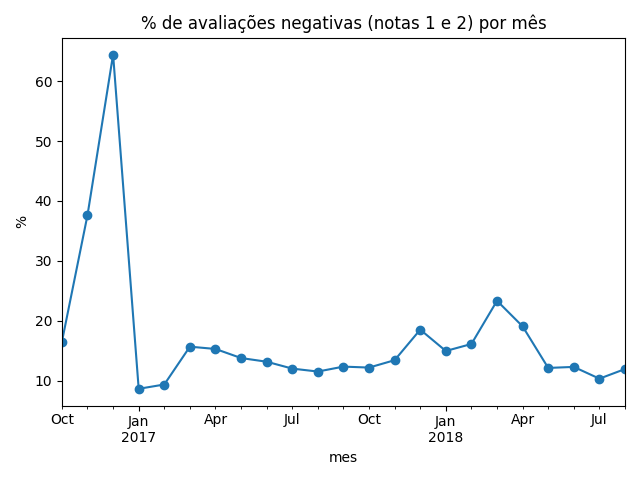
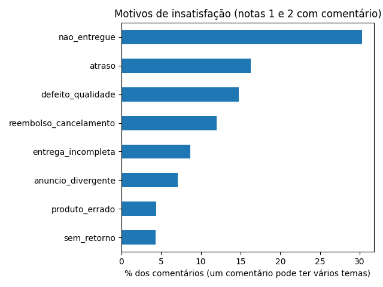
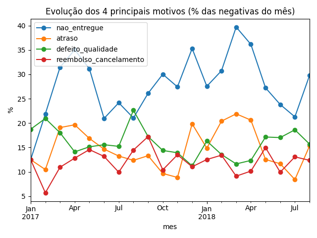

# Radar Feedback
 
Projeto de análise de avaliações de clientes para descobrir **por que as pessoas ficam insatisfeitas** e como isso muda ao longo do tempo.
 
## Pergunta guia
 
> Quais são os principais motivos de insatisfação nos clientes da Olist, e como eles evoluem ao longo do tempo?
 
## Por que este projeto existe
 
A ideia nasceu de um problema real: participei das vendas de produtos do centro acadêmico do meu curso e vi como é difícil transformar o feedback dos clientes em ações concretas. Este projeto é a versão em dados desse problema, aplicada a uma base pública de e-commerce.
 
## Tecnologias
 
- **Python** e **Pandas** para limpeza e análise
- **Matplotlib** para os gráficos
- **Kaggle**: base de dados [Brazilian E-Commerce Public Dataset by Olist](https://www.kaggle.com/datasets/olistbr/brazilian-ecommerce)
- **Gemini API** para apoiar a identificação de temas nos comentários (próxima etapa)
- **VS Code** como ambiente de desenvolvimento
## Sobre os dados
 
O dataset da Olist reúne avaliações reais de pedidos feitos em lojas brasileiras. Este projeto usa o arquivo `olist_order_reviews_dataset.csv`.
 
| Informação | Valor |
|---|---|
| Avaliações originais | 99.224 |
| Avaliações após a limpeza | 98.410 |
| Avaliações com comentário em texto | 40.641 |
| Avaliações negativas (notas 1 e 2) com comentário | 10.758 |
 
## Decisões de limpeza
 
- **Duplicados:** 814 `review_id` apareciam repetidos, ligados a pedidos diferentes (não eram linhas idênticas). Mantive uma linha por `review_id` para que a mesma opinião não pese duas vezes na análise de texto.
- **Título do comentário:** removido, pois cerca de 88% estava vazio.
- **Datas:** convertidas de texto para data.
- **Texto:** espaços extras removidos e comentários vazios tratados como ausentes.
- **Nova coluna `tem_comentario`:** indica quais avaliações têm texto para análise.
## Principais achados (até agora)
 
### 1. As notas são, em geral, positivas
 
Cerca de 58% das avaliações são nota 5, e as notas 1 e 2 somam cerca de 15%. A nota 3 é ambígua, então o foco do projeto são as notas 1 e 2.
 

 
### 2. O volume cresce e a insatisfação oscila
 
O volume de avaliações cresce de forma contínua de 2017 a 2018. A porcentagem de negativas fica na maior parte do tempo entre 10% e 15%, com dois momentos de alta confiável: **dez/2017 (18,5%)** e **mar/2018 (23,3%)**, ambos com mais de 7.000 avaliações no mês.
 


 
> **Atenção:** os meses de out a dez/2016 têm menos de 200 avaliações cada (dez/2016 tem apenas 45, com 64% de negativas). Isso é ruído de amostra pequena, então a análise de evolução começa em jan/2017.
 
### 3. Quem está insatisfeito escreve mais
 
76,6% de quem deu nota 1 deixa comentário, contra 35,9% de quem deu nota 5. Isso concentra o texto onde mais interessa, mas também significa que a análise de texto só enxerga quem escreveu.
 
### 4. A insatisfação é principalmente sobre entrega
 
Classifiquei os 10.758 comentários negativos por palavras-chave em 8 temas. Um comentário pode ter mais de um tema, então as porcentagens não somam 100%.
 
| Tema | % das negativas |
|---|---|
| Produto não entregue | 30,3 |
| Atraso | 16,3 |
| Defeito ou qualidade | 14,8 |
| Reembolso ou cancelamento | 12,0 |
| Entrega incompleta | 8,7 |
| Anúncio divergente do produto | 7,1 |
| Produto errado | 4,4 |
| Falta de retorno da empresa | 4,3 |
 

 
Problemas de entrega (não entregue, atraso e entrega incompleta) dominam as reclamações.
 
### 5. Nos meses de pico, o que sobe é a entrega
 
| Tema | dez/2017 | mar/2018 | Média geral |
|---|---|---|---|
| Produto não entregue | 35,3% | 39,7% | 30,3% |
| Atraso | 19,9% | 21,9% | 16,2% |
 

 
Em mar/2018, por exemplo, cerca de 520 comentários citam falta de entrega, contra cerca de 130 em nov/2017. Os outros temas "caem" nos meses de pico em parte por **diluição**: como as reclamações de entrega crescem, a fatia dos demais diminui, mesmo sem diminuírem em número.
 
**Hipótese ainda não confirmada:** atrasos logísticos nesses meses. Os dados de texto mostram que os clientes reclamaram mais de entrega, mas não provam *por que* a entrega falhou. A confirmação virá das datas de entrega prometida e real do arquivo de pedidos.
 
## Limitações
 
- A classificação por palavras-chave é uma aproximação: cobre cerca de **73%** das avaliações negativas com comentário (27,3% não caem em nenhum tema) e pode classificar errado alguns casos, já que palavras amplas como "ruim" entram em mais de um contexto.
- Casos que dependem de comparar o que foi pedido com o que chegou (ex.: "comprei um cartucho original e recebi pirata") escapam das palavras-chave.
- Parte das notas parece inconsistente com o texto (comentários positivos em notas 1 ou 2).
- A análise de texto só considera quem escreveu comentário.
- Os resultados mostram associação, não causa.
## Estrutura do projeto
 
```
radar-feedbacks/
├── dados/              # CSVs (não versionados, baixe no Kaggle)
├── graficos/           # gráficos gerados pelos scripts
├── src/
│   ├── main.py               # exploração inicial da base
│   ├── limpeza.py            # limpeza e geração de reviews_limpos.csv
│   ├── exploracao.py         # notas, volume mensal e quem comenta
│   ├── leitura_negativas.py  # amostra de comentários negativos para leitura
│   └── motivos.py            # classificação por palavras-chave e evolução mensal
├── .env                # chaves de API (não versionado)
├── .gitignore
└── README.md
```
 
## Como rodar
 
1. Clone o repositório e crie o ambiente virtual:
```bash
python -m venv .venv
source .venv/Scripts/activate   # Git Bash no Windows
pip install pandas matplotlib
```
2. Baixe o dataset no Kaggle e coloque `olist_order_reviews_dataset.csv` dentro da pasta `dados/`.
3. Rode os scripts nesta ordem:
```bash
python src/limpeza.py
python src/exploracao.py
python src/motivos.py
```
 

